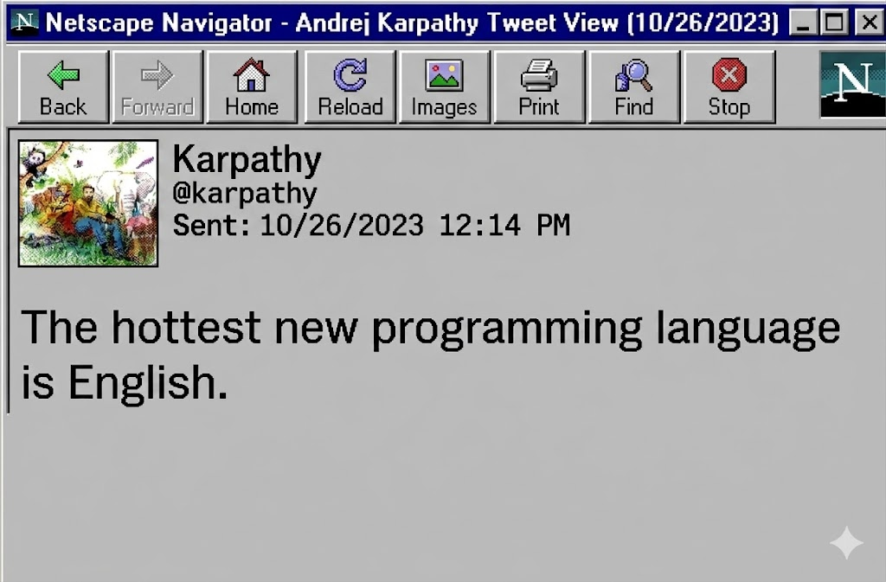
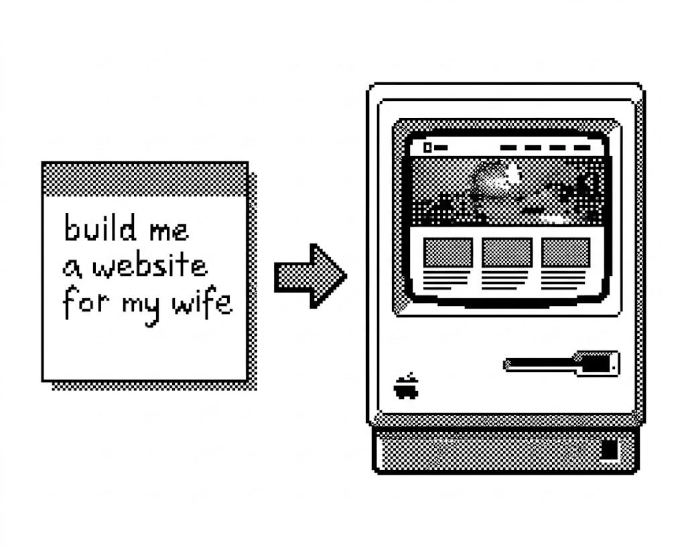
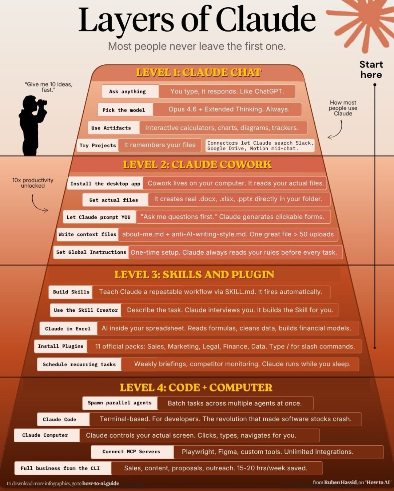

I've been writing this email for a couple months now. What I want to tell you may sound a little crazy or dramatic... but if my brand of crazy is why I'm in your life, read on...

Over the past few months, something fundamental has shifted in what AI can do. Not in a theoretical, Silicon Valley kind of way, in a practical, I-use-this-every-single-day, it-has-changed-how-I-work kind of way. And the gap between what's now possible and what most people think is possible is... crazy.

I'm going to bridge that gap for you. I will explain how you're probably operating on what I'm calling "AI level one", why I'm now at level three or four, and how you can level up to help you in your business and in life. At least your Digital Life.

Because this is one of those moments where being early could make a huge difference.

Figure 1: Someone on the internet said it before I did.

## The Moment It Clicked For Me

Y'all know me... I'm a tech guy. I've been deep in this world for years and been with you through lots of amazing advances. Okay, I missed the first Mac coming out (my family had a lame [Kaypro](https://americanhistory.si.edu/collections/object/nmah_1156670) instead) but I had a front row seat for the rise of the internet, the iPod, the iPhone, Gmail, you name it.

I used [Midjourney](https://www.midjourney.com/) to create fun images back in 2022 (ancient times), Suno to make a few songs, [Mindsera](https://mindsera.com/) to journal, and ChatGPT to replace Google. Not much impresses me anymore, and AI was just a nifty curiosity back then.... but lately? Even I have been cleaning the floor with my jaw at what I'm seeing and doing now.

And no, the advance I'm talking about isn't anything from Apple. It's not the new $600 [MacBook Neo](https://9to5mac.com/2026/03/04/macbook-neo-is-now-official/) (it's gonna be huge). It wasn't the beautiful 50th anniversary letter Tim Cook just dropped on Apple.com which [you should totally read](https://www.apple.com/50-years-of-thinking-different/) after [watching the iconic Think Different commercial](https://www.youtube.com/watch?v=BPX9v8F547k) again... or the fact that he's stepping down as CEO and John Ternus is taking over. And it's definitely not "Apple Intelligence" because the best thing about that "technology" is the acronym: AI. Apple's "AI" and Siri are a joke and haven't really gotten better in years. We kinda all know that... but stay tuned: I'll have something more original to say about that in a minute.

But first, a personnel announcement: I just hired a genius programmer to my team! His name is [Claude](https://claude.com/) and he never sleeps, rarely makes mistakes, codes and reasons and gets work done way better than I've ever been able, even if I had taken computer science in college (which I used to lament and am now REALLY glad I got a well-rounded liberal arts education instead). He's only $20/mo and has leveled up MANY aspects of my business, especially my website design and hosting. I used to be good at managing WordPress websites... now I'm a freakin' genius at it! Yes, I'm taking credit. No, not really.

Towards the beginning of this wave of change in AI, I decided to dredge up a website redesign for my wife that I'd been putting off because it's a project that would normally take me multiple days, research, drafting, organizing, building out the site. In 2025, AI tools were still pretty bad at all of that... in 2026, they became brilliant. This time, I described what I needed in plain English, gave Claude the right context, and came back a few minutes later… the first draft was up. Jaw on the floor. Better than what I would have done in a few hours.

That was my new Tuesday morning.

Figure 2: "Build me a website..." → done.

(If you're thinking "okay Justin, but you're a tech guy, of course you can do that", hold that thought. That's exactly why I'm writing this email. That was level three. I'm going to take you to level two first.)

Here's the thing: if you tried ChatGPT back in 2023 and thought "this makes stuff up" or "this isn't that impressive"… you were right. But that version of AI is ancient history now. The tools available today are genuinely unrecognizable from what existed even right before Christmas 2025. Kind of like comparing a flip phone to an iPhone, same category, completely different thing.

## Most people are only scratching the surface.

Here's what I've noticed with my clients: almost everyone is using AI in a very basic way. You're typing questions into ChatGPT the same way you'd type them into Google. Quick lookups. Simple questions. Maybe drafting a short email. Level one.

And that's fine, it works for that. But it's like driving a Ferrari and only taking it to the grocery store.

Figure 3: Exhibit A.

It's time to imagine more.

AI is phenomenal at generating, summarizing, analyzing, and pattern-matching. It is not good (yet) at: imagination, original judgment, deep relationship building, physical-world problem solving, moral reasoning, cultural intuition, or leading people through ambiguity. We are good at that stuff, and we can leverage our skills now to get more done.

So let me sketch out the full picture, the three levels of AI as I see them right now.

## Level One: AI as a Search Engine

Most people.

You ask questions. You get answers. Maybe you use it to test an idea, draft a quick message, summarize an article. It's useful, but the AI doesn't know much about you, your business, your goals, your situation. Every conversation starts great but if it gets long, it forgets stuff. It's Google with better grammar and fewer ads.

## Level Two: AI as a Working Partner

Blending chats and whole folders of stuff.

At Level Two, you're not just asking the AI questions, you're working with it. You're giving it lasting context about who you are, what you're trying to accomplish, and what matters to you. You're using it to pressure-test your ideas, challenge your assumptions, and find the blind spots in your thinking. It's creating project specs and keeping track of progress. It's even building spreadsheets and dashboards so you can see and use your data.

Tools like Claude's Cowork let you do something that wasn't possible even a few months ago: give the AI access to your actual files and documents, connect it to your email and calendar, and have it work alongside you on real tasks. Your actual Tuesday morning.

## Level Three: AI as Builder

Where my businesses got reimagined.

This is where things start to become sci-fi, even to me.

At Level Three, you're not just working with AI, you're building through it. Tools like [Claude Code](https://claude.com/product/claude-code) let you describe an app, a tool, a system, in plain English, and have the AI build it for you. I'm not talking about a rough wireframe. I'm talking about a working product. It writes the code, tests it, refines it, and delivers something functional... with your help and direction.

A year ago this wasn't possible. Six months ago it was clunky. Today it's worth sending you this email about.

You don't need to be a programmer. You don't need a technical background. You need to have good ideas, clearly describe what you want, give it good context, and iterate on the result. That's it. Human words. [The hottest new programming language is English.](https://x.com/karpathy/status/1617979122625712128)

Figure 4: The Layers of Claude.

> "AI will not take your job. But someone who knows how to use AI will."

## What's next for us humans?

For years I've been teaching humans how to use computers. I'm really good at it, but it's not the break/fix stuff that makes me valuable. Many of you are already using ChatGPT to help you solve small issues on your computer and often that works. When Apple finally comes out with a good version of Siri, you'll turn to it instead of [my booking link](https://support.maccog.com/) because it's faster. But I've got skills it never will: human judgement, empathy, experience, and a real relationship with YOU.

I've also got the knowledge you need to actually harness these tools without going through the learning curve us early adopters have had. What crap work would you LOVE to get rid of? How can you leverage AI to spend more time on creative thinking and less time doing busywork? And how do we adapt?

When we're done pontificating on the meaning of human labor in the age of AI, I'll explain how you give Claude the right role, the right context, the right examples, the right tools, and the right instructions to make it the assistant you always dreamt of. Genius. Adaptable. Reasonable. And always ready when you are.

This is the way I'm doing work now, with Claude. I'm still your ["Digital Life Coach"](https://maccog.com/). I help humans navigate technology because change is the only constant, especially now.

> "The goal isn't to outsource your thinking. It's to accelerate it."

## Why I'm Telling You This Now

The people who develop real fluency with these tools will have an extraordinary advantage. Most haven't even started.

I've spent the last several months going deep on all of this, studying, testing, building, and learning what works. Helping you build my battle-tested system, customized to you... is kinda what I've always done, and I want to do it with AI too.

That's what I do. The tools change, but the need for someone who can translate what's happening and help you apply it to your specific situation? That doesn't go away.

Figure 5: Happy Birthday, Apple! You're older than me.

[Book some time with me](https://support.maccog.com/) to have a chat about it. I'm doing a limited number of personalized AI setups and building a skill library to share with you... and I'm considering a Slack community to talk about it. Let me know if you're interested in that, too!

Justin
