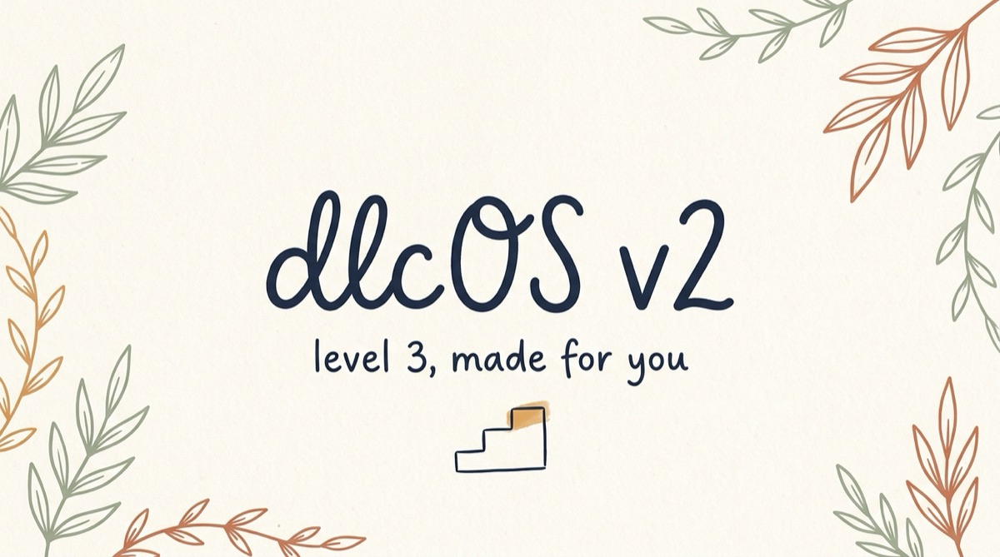
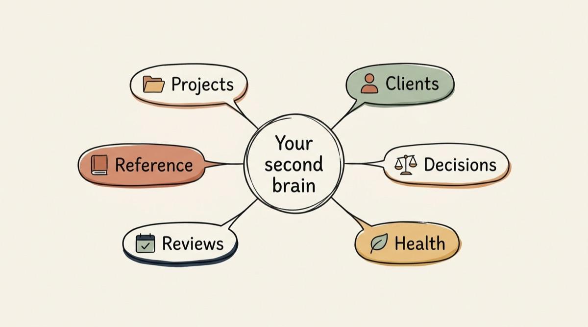

Summer is gone. Kellan just started high school and is already overwhelmed with stuff to do, Auggie prefers to sleep in my mancave now and Crystal is holding it all together while singing in two bands! And I'm using Claude basically all of the time I'm not talking to one of you.

I'm finally getting around to writing this because I made you a promise a few months back, and it's time to deliver part two.

## the promise of modern AI

In my last email, I laid out three levels of AI use. Quick recap:

- Level 1: AI chat bots as a rad search engine. You type a question, you get a great answer. Most people are here.
- Level 2: AI as a thinking and document partner. You bring it your real problems and it helps you not only think through them but create the first draft. A genuine accelerant once you feel it.
- Level 3: AI as a builder. You describe what you want with some English, and it builds real, working systems.

I love this quote from the guy I consider to be the father of LLMs Andrej Karpathy:

> "The hottest new programming language is English."

Another zinger:

> Any person with clear thinking, zero coding background, and something specific they want to build... can build it.

Today I want to show you what I'm building.

## I call it dlcOS

Short for the "Digital Life Coach Operating System." I know that sounds like a lot, so let me tell you what it is in plain language.

It's a system that turns AI from "a chatbot I ask questions" into something closer to an operating partner for my life and business. Still imperfect, still requiring a lot of steering from me... but much, much more useful than a chat window.

The foundation is a single folder on my computer where everything lives: my notes, my projects, client relationships, decisions I've made and why I made them, my goals, weekly reviews, years of accumulated reference knowledge.

It's basically my personal Wikipedia, but built for an AI to use with me. My AI reads from it and writes back to it. I don't have to re-explain who I am, what I'm building, or where we left off every time I start a new conversation.

On top of that, I built a small team of specialized AI helpers.

One drafts emails in my voice. I read and edit. One searches my entire knowledge base by meaning, not keywords, so when I ask "what did I decide about X three months ago?" I get a good answer. One does web research with a strong preference for primary sources. One keeps the whole system organized and coherent.

And here's the coolest part: they're learning along with me.

## what looks different now

Last week I started the morning the way I start most mornings now. I read a brief where my agents had pulled together what was happening across all my open projects, any follow-ups I owed people, and a handful of things worth having on my radar.

Later that morning, I needed to pick up a client project I hadn't touched in three weeks. In the old world, that would mean fifteen minutes of "where was I?" archaeology. But my agents had written a handoff file when we paused it: the exact state of the project, the open decisions, the context I needed to move forward clean. Start a Claude session in the right folder and I was back in it.

That afternoon I needed to send a proposal to a client. I described what I wanted to say. My AI teammate read the relevant emails and the transcription of our Zoom meeting and quickly drafted it in my voice, with the right tone, knowing the client's history. I read and made necessary edits and sent it. In my old world, that took days.

And then Friday: the weekly review. My AI and I walk through the whole week together. What got done, what didn't, what I'm still carrying, where I'm starting to drift. My weekly review used to feel like a chore, now it has become the most useful hour of my week.

## and it's private

Maybe my favorite part of this system is that it lives and runs on my computer. My private data (and yours) are kept only on my computer. No AI or tech company is storing and mining that data for ads or the next AI model. It's my data, and it's local.

I can't really overstate this. It may sound esoteric but to take a small step back, I've been annoyed by vendor lock-in for decades. "You can use our tools but your data kinda belongs to us because we keep it in the cloud for you." We've all just accepted this as reality, but with AI, it doesn't have to be that way. You can be the steward of your own data! You can keep it private when you want and share it only when you want. Crazy concept, I know.

## the thing that still gets me

Here's what I didn't expect.

When dlcOS v2 shipped back in June, the part that surprised me most was how cumulative it started to feel.

Each of those specialized helpers I mentioned? After a task, they can propose what they learned. Short, specific lessons. "This kind of draft needs less setup." "For this research question, source date matters more than search ranking." Things like that. I review them, keep the good ones, and those lessons get added permanently to how each agent works going forward.

It gets sharper every week, because it's doing real work and we're both paying attention.

I've been using AI tools since the early days. This is the first time something has felt cumulative to me. Not just "better answer this time," but "this whole setup knows more about how to help me than it did last week."

That's a different category of tool than anything we've ever had before!

## the reframe I keep coming back to

I'm sure some of you are thinking: "okay, but you're a tech person."

I didn't build dlcOS by sitting down and programming it the old way. I described what I wanted in plain English: here's what I need, here's the context, here are the rules, here's what good looks like. My AI built pieces of it. I reviewed, corrected, pushed back, and steered.

The bottleneck is less and less about technical skill. It's knowing what you want clearly enough to say it out loud. That's a thinking skill. A clarity skill. A human skill. And it's the exact skill I work on with people in coaching sessions.

Here's the other thing I want you to hear: you probably don't need the whole system.

Most people I'm talking with right now just need Level 2: the first 20% of this, applied to their life. What does that look like? It's smaller than you think. It's: what if your AI knew your context? What if you used it consistently for two or three specific things that currently drain you? Not everything. Not an "operating system." Your most useful two or three workflows, done with an AI that carries your context forward instead of starting over every time.

## ready to figure out your version?

Book a short session with me. We'll look at your actual life, your actual work, and map out what your first 20% might look like. What are you re-explaining to your AI? Where's the friction? Where is the opportunity for you?

[Book a session](https://support.maccog.com/)

Justin

P.S. One thing you can try this week, no system required. Before your next big task, open your AI of choice and spend three minutes using the dictation button to explain the full context. The history. Who's involved. What you're trying to accomplish. What you've already tried. Just ramble on about it as if you're telling a friend (a friend who cares) and be more specific than feels necessary. Then ask for help. What comes back may surprise you. That's the beginning of Level 2. And once you feel that shift, you'll understand why Level 3 is worth the work.
